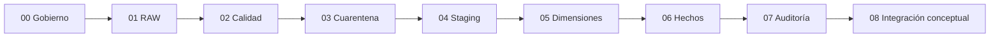
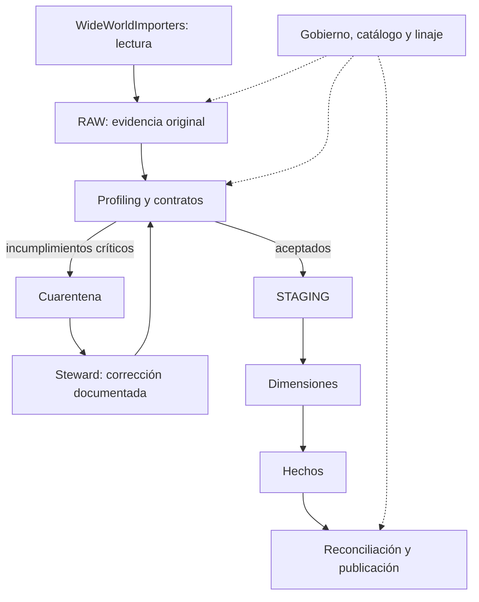
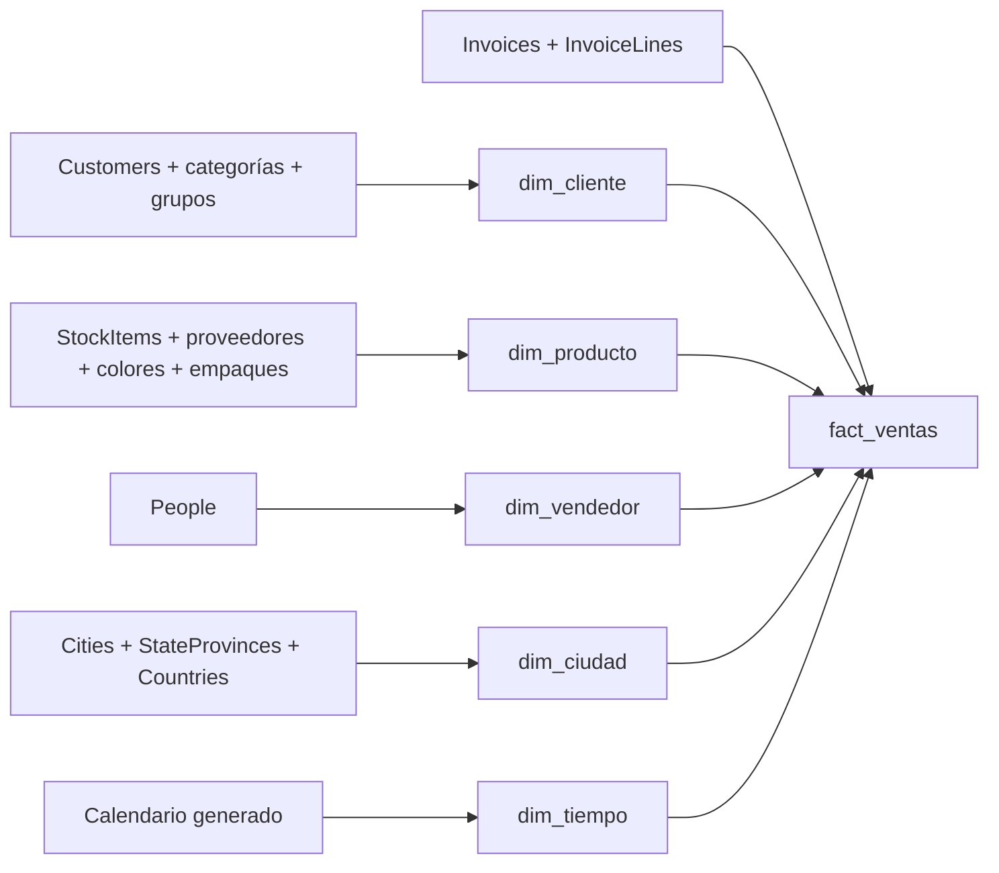
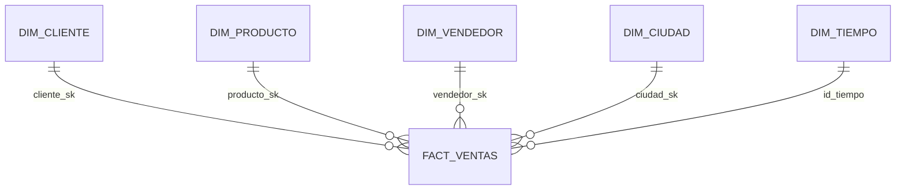
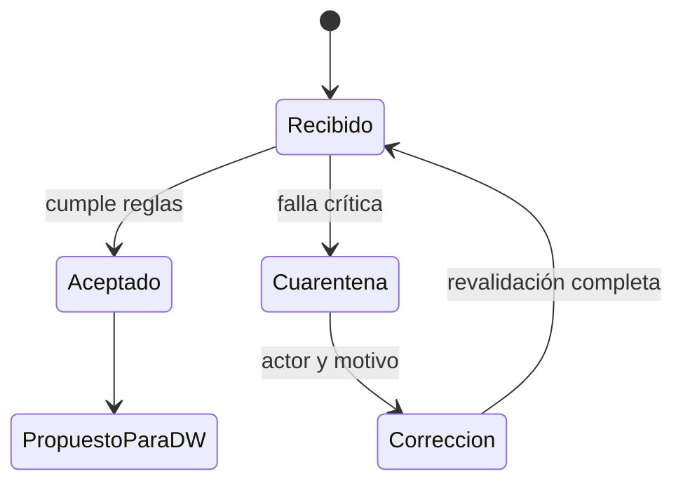
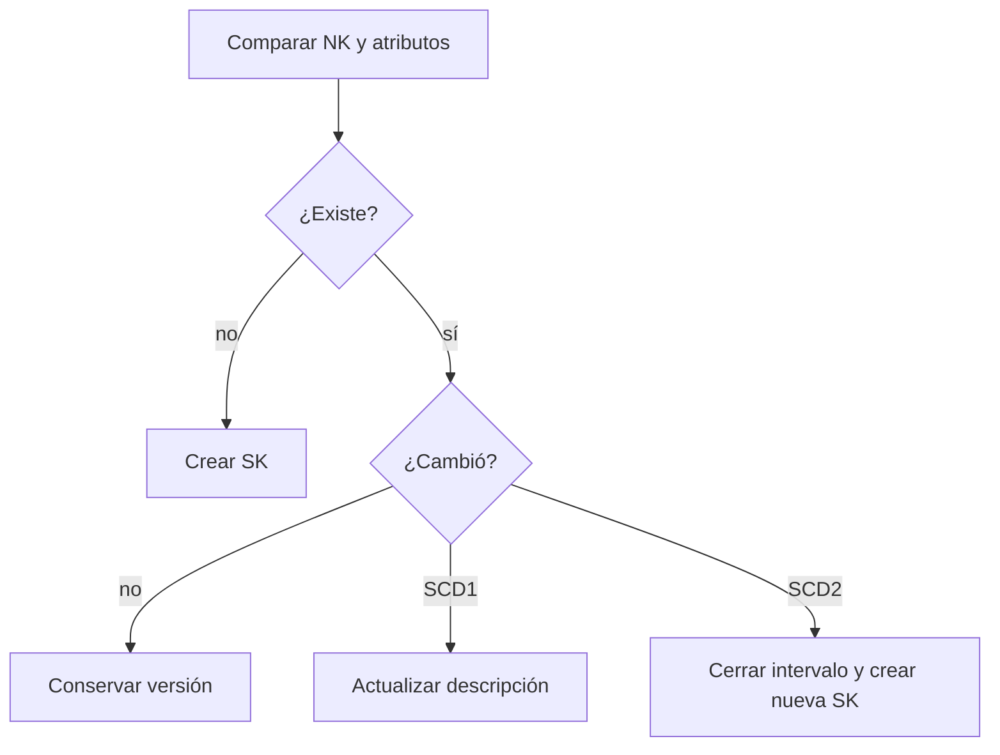
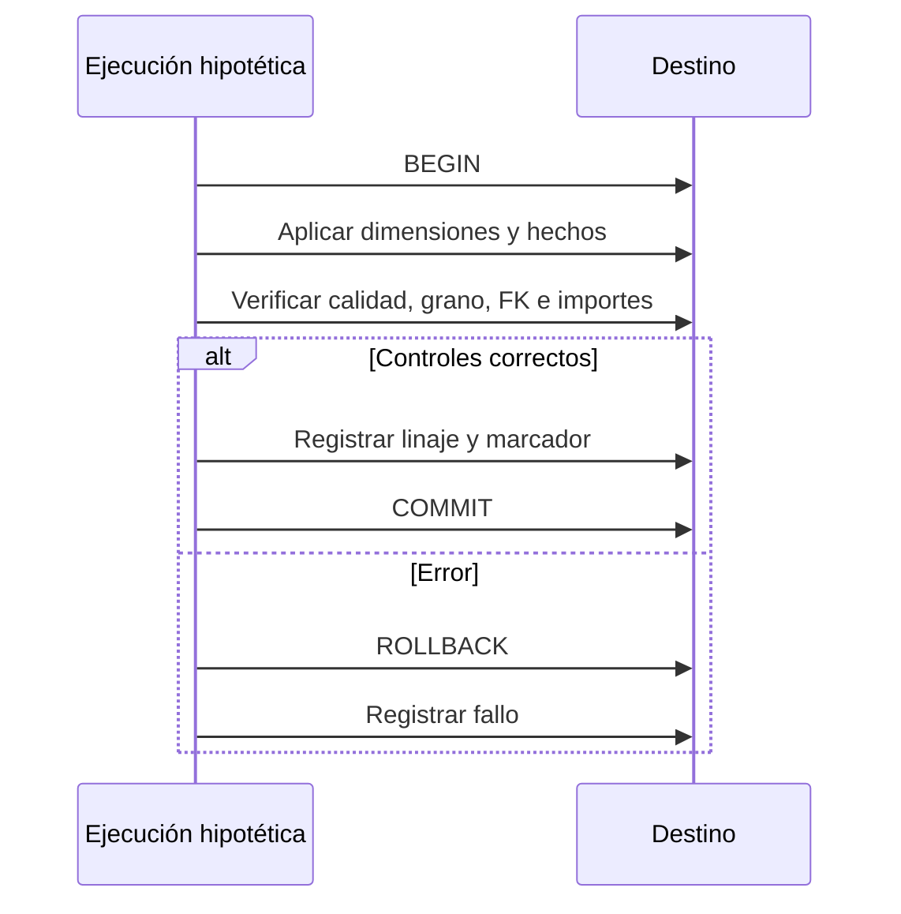
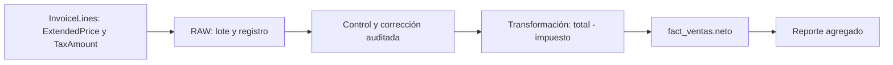

# Material de clase: ingesta, calidad y gobierno hasta el DWH

**Esta entrega es material para explicar, no una implementación de pipeline.**
Contiene únicamente nueve notebooks Jupyter, este README y
[requirements.txt](requirements.txt).

No hay scripts `.py`, tests, aplicación, generador, orquestador ni conexiones a
bases. Las celdas operan con datos ficticios **en memoria**. El SQL incluido es
texto explicativo: no se ejecuta en SQL Server.

Las notebooks originales de la unidad IV no se modificaron.

## 1. Uso en clase

1. Instala las dependencias en un entorno Python 3.10–3.12:

   ```powershell
   python -m pip install -r notebook\unidad_IV\pipeline_ingesta\requirements.txt
   ```

2. Abre los `.ipynb` con Jupyter o con la extensión Jupyter de VS Code y
   selecciona ese entorno como kernel.
3. Explica las celdas Markdown y ejecuta los ejemplos que quieras mostrar.
4. Cierra cada tema con la actividad de discusión incluida.

Cada notebook es **independiente**: no importa otra notebook, no necesita un
`.py` ni comparte estado con otra sesión. No requiere SQL Server, credenciales
ni una base preparada. Para abrirlas con interfaz web necesitas un servidor
Jupyter existente; los requerimientos no instalan JupyterLab.

La dependencia Great Expectations se usa solo en la celda señalada de 02.
Se fija la versión 0.18.22 porque su API difiere de versiones posteriores.
No se necesitan SQLAlchemy ni pyodbc: no vamos a efectuar una ingesta.

## 2. Recorrido de las notebooks

| Notebook | Qué explicar | Ejemplo local |
|---|---|---|
| [00 · Preparación y gobierno](00_preparacion_gobierno.ipynb) | Alcance, 13 tablas, catálogo, roles y PII. | Mapa origen-destino y diccionario. |
| [01 · Extracción RAW](01_extraccion_raw.ipynb) | Snapshot, lote, conteo y evidencia original. | Dos registros con hash. |
| [02 · Profiling y contratos](02_profiling_contratos.ipynb) | Seis dimensiones, reglas, severidad y umbrales. | Perfil pandas, motivos y contrato GE. |
| [03 · Cuarentena y reproceso](03_cuarentena_reproceso.ipynb) | Aislar, revisar y revalidar sin alterar RAW. | Corrección con actor, motivo, antes y después. |
| [04 · Staging](04_staging.ipynb) | Transformaciones, relaciones e importes. | LEFT JOIN con diagnóstico de huérfano. |
| [05 · Dimensiones](05_dimensiones.ipynb) | NK/SK, SCD1, SCD2 y calendario. | Búsqueda en intervalo semiabierto. |
| [06 · Hechos](06_hechos.ipynb) | Grano, medidas y resolución de claves. | Dos líneas con una nota de crédito. |
| [07 · Auditoría y publicación](07_auditoria_publicacion.ipynb) | Reconciliar, bloquear y explicar linaje. | Decisión de publicación en memoria. |
| [08 · Caso integral](08_demo_integral.ipynb) | Unir conceptos en una historia de clase. | Rechazo, corrección y hechos propuestos. |



Estas flechas representan el **orden de explicación**, no una dependencia
técnica ni una ejecución automática.

## 3. Arquitectura conceptual de ingesta



Versión textual si tu visor no representa Mermaid:

```text
DB -> RAW -> Calidad -> STAGING -> Dimensiones -> Hechos -> Auditoría
               |
               +-> Cuarentena -> Corrección -> Revalidación

Gobierno y linaje acompañan todas las etapas.
```

**Origen y destino que se explican:** `WideWorldImporters` →
`WideWorldImportersDW2`. No se conectan ni se crean en estas notebooks.

## 4. Las tablas y su impacto en el modelo

| Origen | Aporte al DWH |
|---|---|
| `Sales.Customers` | Cliente y referencias para ventas. |
| `Sales.CustomerCategories` | Categoría de cliente. |
| `Sales.BuyingGroups` | Grupo comprador. |
| `Warehouse.StockItems` | Producto. |
| `Purchasing.Suppliers` | Proveedor del producto. |
| `Warehouse.Colors` | Color del producto. |
| `Warehouse.PackageTypes` | Empaque y validación del detalle. |
| `Application.People` | Vendedores. |
| `Application.Cities` | Ciudad. |
| `Application.StateProvinces` | Provincia/estado. |
| `Application.Countries` | País. |
| `Sales.Invoices` | Cabecera: cliente, vendedor y fecha. |
| `Sales.InvoiceLines` | Grano y medidas de ventas. |



No se construye una dimensión por cada tabla normalizada. Las tablas auxiliares
aportan atributos descriptivos a una dimensión desnormalizada.

### Modelo estrella



**Grano: una fila por `InvoiceLineID`.** Una factura de tres líneas genera tres
hechos. En 06 se muestran dos dimensiones para hacer legible el mecanismo,
no una carga completa de las cinco.

En WWI:

```text
total = ExtendedPrice                 (incluye impuesto)
impuesto = TaxAmount
neto = ExtendedPrice - TaxAmount
```

Precio unitario y tasa no son aditivos. Los montos se calculan con Decimal.
`UnitPrice` admite NULL; `TaxRate` admite tres decimales. No rechazar notas
de crédito solo por sus signos negativos.

## 5. Calidad y cuarentena

| Dimensión | Pregunta para los estudiantes |
|---|---|
| Completitud | ¿Falta un valor realmente obligatorio? |
| Unicidad | ¿Se repite la clave? |
| Integridad | ¿Existe el padre referenciado? |
| Consistencia | ¿Tipos y relaciones respetan las reglas? |
| Vigencia | ¿La extracción llega dentro del SLA? |
| Exactitud | ¿Coincide con una referencia confiable? |

Un formato válido no demuestra exactitud. Una venta antigua no implica ingesta
atrasada. `LastEditedWhen` sin zona no se debe asumir UTC.



Una fila puede tener varios motivos. Siempre distinguir:

```text
extraídas = aceptadas + rechazadas
```

de:

```text
cantidad de incumplimientos = suma de motivos
```

En 02 hay **dos filas rechazadas y cinco incumplimientos**. En 03 una fila
presenta dos motivos. El overlay de corrección mantiene el RAW original.

## 6. Historia y claves



En el modelo de referencia cliente y producto usan SCD2; vendedor y ciudad,
SCD1. Los intervalos de 05 son ficticios y están dados para explicar la
búsqueda: no se reconstruye historia pasada a partir de un snapshot actual.

La fecha de factura y la fecha de observación SCD no son intercambiables.
La ciudad actual del cliente no garantiza su ciudad histórica de entrega.

## 7. Publicación y linaje: qué exigiríamos en un sistema real



Este diagrama es una explicación. Las notebooks **no abren transacciones ni
prueban un rollback real**.



En 07 el balance de filas cuadra, pero la publicación se bloquea por cuarentena
con tolerancia cero. **Reconciliación no equivale a aprobación de calidad.**
Algunos controles se declaran como condiciones del caso para discutirlos;
no se afirma haber medido FK o grano en un warehouse.

## 8. Gobierno y responsabilidades

| Rol | Decisión |
|---|---|
| Owner | Define significado de venta, usos y tolerancias. |
| Steward | Formaliza reglas y revisa correcciones. |
| Engineer | Implementaría controles y recuperación. |
| CDO | Define políticas y responsabilidades. |
| DBA | Aplicaría permisos, cifrado y medidas técnicas. |

Los nombres personales siguen siendo PII aunque eliminemos correos y teléfonos.
Un catálogo no implementa acceso controlado. No se aplican RBAC, anonimización,
retención ni seguridad productiva en esta entrega.

## 9. Guion de cierre

La notebook 08 cuenta la historia completa con dos registros ficticios:

1. Una línea tiene producto inexistente y total inválido.
2. Se bloquea su propuesta.
3. Se documenta una corrección.
4. Se revalida.
5. Se obtienen dos hechos propuestos.

Resultado: **neto 15.00, impuesto 3.15, total 18.15**.

Preguntas:

- ¿Por qué un INNER JOIN puede ocultar un error de calidad?
- ¿Qué pierde un reporte al ignorar cuarentena?
- ¿Por qué guardar el actor no reemplaza validar el dato corregido?
- ¿Qué evidencia falta para decir que los datos son exactos?
- ¿Qué habría que agregar para pasar de una explicación a una solución real?

## 10. Alcance y referencias

No se incluye pipeline ejecutable, extracción de bases reales, persistencia,
jobs, CLI, pruebas entregables, despliegue, CDC ni garantías de concurrencia.
Los ejemplos son ilustrativos y pequeños, no una implementación productiva.

- [Unidad III: calidad y gobierno](../../../documentacion/unidad_03_calidad_del_dato_y_gobierno/)
- [Dimensiones originales de unidad IV](../01_kimball_create_DIM.ipynb)
- [Hechos originales de unidad IV](../02_kimball_create_FACT_VENTAS.ipynb)
- [Esquema oficial WWI: InvoiceLines](https://github.com/microsoft/sql-server-samples/blob/master/samples/databases/wide-world-importers/wwi-ssdt/wwi-ssdt/Sales/Tables/InvoiceLines.sql)
